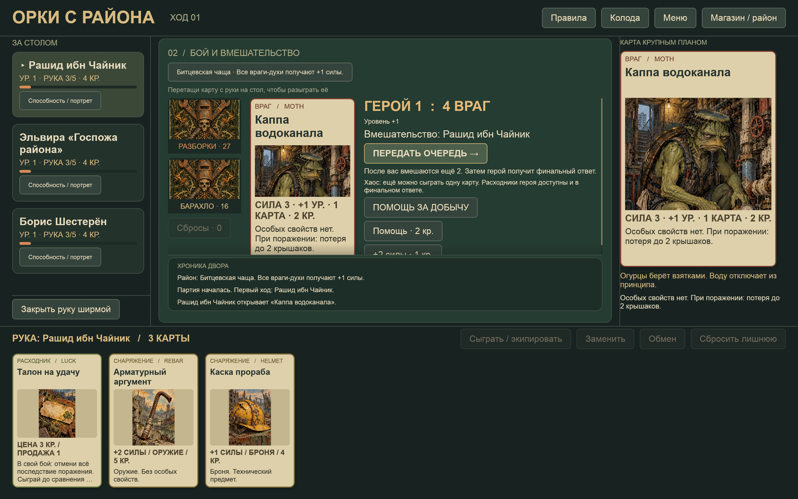
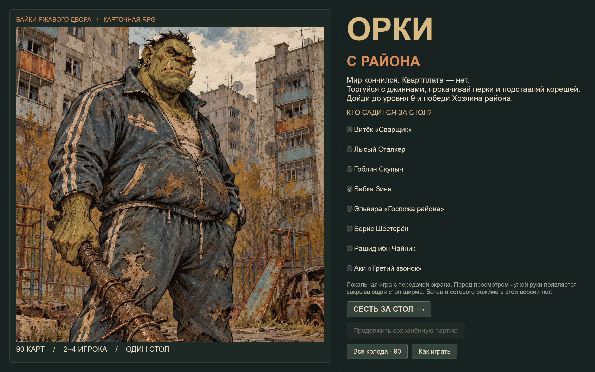
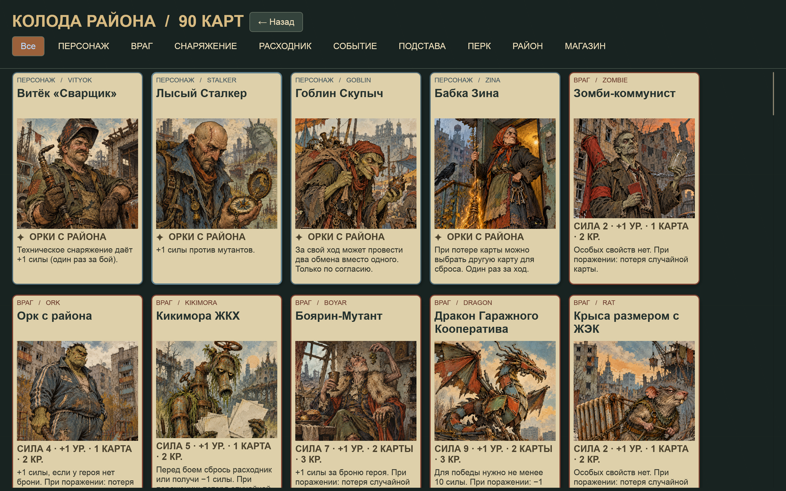

<div align="center">

# Орки с района

### Мир кончился. Квартплата — нет.

Карточная RPG о соседях, подставах и последнем свободном подъезде.

[](https://github.com/villetacore/orcs-from-the-neighborhood/actions/workflows/ci.yml)
[](https://github.com/villetacore/orcs-from-the-neighborhood/releases)
[](LICENSE)
[](Cargo.toml)

[Скачать](https://github.com/villetacore/orcs-from-the-neighborhood/releases/latest) · [Правила](rules/quickstart.md) · [Мир игры](docs/game.md) · [Сообщить об ошибке](https://github.com/villetacore/orcs-from-the-neighborhood/issues/new/choose)



</div>

Москва, 2055 год. После Великого Перекоса эльфы, гномы, джинны и орки делят
панельные дворы, метро и ночные рынки. Восемь фракций спорят за изменившийся город,
а вам предстоит собрать снаряжение, заработать крышаки и бросить вызов Хозяину района.

**2–4 игрока · один компьютер · русский язык · взрослый юмор 18+**

## Что внутри

- **90 карт:** восемь героев, враги, снаряжение, события, подставы и магазин.
- **Две колоды:** Разборки и Барахло; открытая витрина, продажа и бартер.
- **Развитие:** 18 перков, шесть районов и общее финальное испытание.
- **Переговоры:** добровольная помощь, плата добычей или монетами и предательство.
- **Автосохранение:** продолжение партии и ширма для приватных решений.
- **Бумажная версия:** печатная колода 63 × 88 мм и модели монет для 3D-печати.

Игра работает локально, без аккаунта и серверной части. Сети, ботов и звука пока нет.
Иллюстрации созданы с помощью генеративных инструментов; промпты и сведения о
повторном использовании мотивов открыты в [prompts/](prompts/style-guide.md).

## Скачать и играть

Откройте [Releases](https://github.com/villetacore/orcs-from-the-neighborhood/releases/latest),
скачайте ZIP для своей системы и **распакуйте весь архив**.

| Система | Архив | Запуск |
|---|---|---|
| Windows x64 | `windows-x86_64.zip` | `orcs-from-the-neighborhood.exe` |
| Linux x64 | `linux-x86_64.zip` | `./orcs-from-the-neighborhood` |
| macOS Apple Silicon | `macos-aarch64.zip` | `Orcs from the Neighborhood.app` |
| macOS Intel | `macos-x86_64.zip` | `Orcs from the Neighborhood.app` |

Полные имена архивов включают название игры и версию. Системные требования,
запуск неподписанной сборки и проверка контрольных сумм — в [INSTALL.md](INSTALL.md).
Rust для готовых сборок не нужен.

Выберите 2–4 разных героев и нажмите **«Сесть за стол»**. При появлении ширмы
передайте экран указанному игроку. Карты можно играть кнопкой или перетаскивать
на стол. Кнопка **«Магазин / район»** открывает витрину и правило текущего района.
На уровне 9 со следующего своего хода доступен вызов Хозяина района.

<details>
<summary>Ещё два взгляда на игру</summary>




</details>

## Собрать из исходников

Нужны Rust **1.95+**, компоновщик и системные зависимости Bevy.
Для CI закреплена версия в [rust-toolchain.toml](rust-toolchain.toml).
На macOS установите Xcode Command Line Tools, на Windows — Visual Studio Build Tools
с компонентами C++ и Windows SDK.

```sh
git clone https://github.com/villetacore/orcs-from-the-neighborhood.git
cd orcs-from-the-neighborhood
cargo run --release --locked
```

Linux: зависимости для Ubuntu/Debian перечислены в [CONTRIBUTING.md](CONTRIBUTING.md).
На macOS также можно открыть `run-game.command`.

```sh
cargo run --locked -- --preview
cargo run --locked -- --screen gallery
cargo run --locked -- --check-assets
cargo run --locked -- --help
```

`--preview` открывает демонстрационный стол без записи сохранения;
`--screen menu|table|gallery|rules` выбирает экран;
`--capture out.png` делает снимок окна и выходит;
`--save file.json` задаёт файл сохранения.
Ресурсы находятся рядом с программой или в `.app`; `ORCS_ROOT` позволяет указать их корень вручную.

## Бумажная игра

Откройте [output/deck.html](output/deck.html) из локальной копии репозитория:
90 карт, 10 листов A4 с лицами. Печать **100%**, поля **10 мм**, без колонтитулов,
с включённой фоновой графикой. Сохраняйте структуру папок: HTML использует `assets/art/`.
Рубашки двух колод различаются цветом и надписью. Сначала проверьте размер одной
карты линейкой; автоматического совмещения двусторонней печати нет.

[Монеты для 3D-печати](output/coins/README.md): номиналы 1, 5 и 10, OpenSCAD и STL.
Для пробной партии подойдут любые жетоны. Физическая печать пока не проверена.

## Документация

| Документ | Содержание |
|---|---|
| [Правила](rules/quickstart.md) | Подготовка, ход, бой, магазин, помощь, перки и победа; доступны и в игре |
| [Мир игры](docs/game.md) | Москва после Перекоса, восемь фракций и герои |
| [Карта Москвы](assets/maps/moscow-factions.png) | Районы, фракции и спорные зоны |
| [Архитектура](docs/architecture.md) | Движок, клиент, данные и сохранения |
| [План развития](docs/plan.md) | Следующие задачи и ограничения |
| [Проверки](docs/validation.md) | Проверенные сценарии и границы проверки |
| [Аудит контента](output/content-audit.md) | Все 90 карт, решения и очередь иллюстраций |
| [Выпуск версий](docs/releasing.md) | CI/CD, упаковка и публикация по тегу |

## Участие в проекте

Ошибки и предложения принимаются через
[Issues](https://github.com/villetacore/orcs-from-the-neighborhood/issues).
Перед pull request прочитайте [CONTRIBUTING.md](CONTRIBUTING.md).
История изменений — [CHANGELOG.md](CHANGELOG.md).

Проект находится в активной разработке. Автоматические партии проверяют правила
и сохранность карт; баланс, длительность и удобство требуют живых партий.
Старый Godot-прототип хранится в `legacy/godot/` и не участвует в сборке.

## Лицензия

[MIT](LICENSE) · © 2026 **villetacore**. Условия зависимостей определяются их собственными лицензиями.
