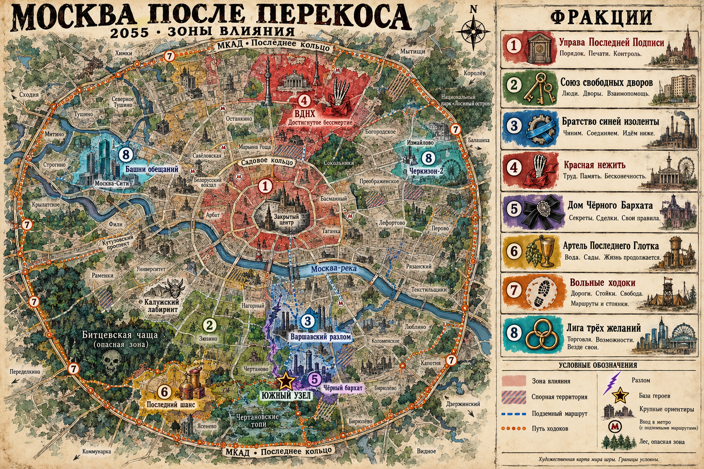

# Мир, история, фракции и контент

Единое описание творческого направления. Правила партии находятся в [rules/quickstart.md](../rules/quickstart.md), устройство реализации — в [architecture.md](architecture.md). План дальнейшей работы — в [plan.md](plan.md).

## Питч

Москва, 2055 год. Восемнадцать лет назад Великий Перекос наложил город на чужие миры. Теперь дворы держат орки и ведьмы, метро чинят гномы, зомби проводят партсобрания, а эльфийская госпожа торгуется с хозяевами инфраструктуры. В Южном узле восемь авантюристов пытаются сохранить свой адрес и стать местной легендой. Мир кончился, а квартплата — нет.

Соревновательная карточная RPG для 2–4 взрослых игроков: снаряжение, бои, переговоры, торговля и подставы. Проектируемая длительность — 45–70 минут, объяснение за 10 минут; это цели для живого теста, а не измеренный результат.

## Взрослый комизм

Тон — дерзкая взрослая комедия о похотливых амбициях, похмелье, власти, жадности и плохих решениях. Творческий ориентир аудитории — 18+, не установленный возрастной рейтинг. Бытовая сатира остаётся фоном; в центре — гротескные персонажи и сомнительные приключения.

Взрослые темы должны быть заметны на самих картах: БДСМ-эльфийки, бессмертные алкоголики, зомби-коммунисты, сталкеры с мутными трофеями, гномьи пьянки, суккубы с платными курсами и гаражные секты. Двойные смыслы, грубоватые реплики и чёрный юмор — часть основного голоса игры. Не сводить всю колоду к шуткам про отчёты и квитанции.

Примеры из текущего каталога:

- Эльвира «Госпожа района»: «Эльфийка, 312 лет. БДСМ-салон пережил конец света. Стоп-слово — “ипотека”».
- Зомби-коммунист: «Мозги — народу. Печень уже обобществили».
- Эльф запойного подряда: «Бессмертие есть. Печени на него не рассчитали».
- Трёхголовый Тузик: «Три головы. Одна пьёт, вторая врёт, третья звонит бывшей».
- Заседание мёртвой ячейки: «Кворум есть. Пульса нет. Повестка прежняя».
- Энергетик «Отходняк»: «Ночь с суккубом. Утро с последствиями».

Сексуальный юмор строится на характерах, намёках, костюмах и словах; без изображения половых актов и интимных подробностей. В двусмысленных ситуациях все персонажи явно взрослые, участие добровольное. Политическая сатира — про вымышленных зомби-парторгов и их вечную повестку. Алкоголь, сомнительные культы и мутные сделки дают комические последствия, а не практические инструкции.

У персонажа должна оставаться компетенция: госпожа Эльвира отлично договаривается, гном умеет чинить, сталкер знает Зону. Не превращать каждого в одинакового пьяницу. Формат карты: короткое название, однозначное правило, отдельная реплика. Юмор не маскирует цену и ограничения.

## Москва после Перекоса

**Москва, осень 2055 года. Восемнадцать лет после Великого Перекоса.** Это вымышленная будущая Москва: узнаваемые места, сломанная география и авторская история. Реальные названия дают ориентиры; устройство районов после катастрофы принадлежит игре.

До катастрофы здесь уже жили чужаки. Джинны открывали ремонтные мастерские, гномы работали под землёй, эльфы застревали в человеческих романах, домовые делили квартиры с хозяевами. Их скрывали старые договоры: люди видели странных соседей и предпочитали не задавать вопросов. Полного сообщества никто не замечал — каждый знал только свой кусок тайны.

В 2037 году экспериментальная система «Единый адрес» попыталась сопоставить всех жителей, здания, подземелья и бесхозные пространства Москвы. Проект соединял городские сети с найденным под землёй магическим **Адресным камнем**. Камень отвечал за более древний порядок: у каждого места должны быть имя, хозяин и граница.

Запрос «показать всех фактических жильцов» захватил живых, мёртвых, духов и соседние реальности. Система стала выдавать им один и тот же адрес. Дом в Чертанове оказался одновременно панелькой, эльфийским родовым владением и выходом на чужое болото. Метро подключилось к подземным королевствам. Вода подняла существ, которым никто не выдавал ключи от подвала.

Эту ночь назвали **Великим Перекосом**, а на юге — **Ночью последнего обновления**. Шли пожары, рушились перекрытия, исчезали целые переходы. Погибли и пропали люди. Обещанный откат системы так и не произошёл. Большая часть города уцелела кусками, между которыми стало трудно и опасно добираться.

Теперь Москва населена и живёт: торгует, чинится, влюбляется, пьёт, воюет за воду. В некоторых кварталах работают лампы и печи; в других комнату можно потерять вместе с целым этажом. Метро даёт самые ценные пути, поверхность — больше пространства и больше неожиданных соседей. Взрослая комедия возникает из того, как люди устраивают жизнь посреди настоящих потерь и опасностей.

### За пределами города

Внешний мир существует. По старым дорогам приходят караваны, ходят слухи о других городах и собственных катастрофах. МКАД стал неровной магической границей: одни выезды проходимы, другие возвращают в Москву, третьи ведут в чужую землю. Выход требует подходящего пути и проводника, а не победы в основной партии. За МКАДом нет гарантированного спасения, зато есть пространство для будущих историй.

Точная судьба остальной страны пока остаётся неизвестной героям. Для московского набора не фиксировать мировую войну, всемирную гибель или политическую карту всей планеты.

## Как Москва дошла до нынешнего состояния

| Время | Событие | Что осталось в игре |
|---|---|---|
| До 2037 | Скрытые общины и старые договоры сосуществуют с обычным городом | Эльвира уже знает Москву; Борис и Рашид не впервые имеют дело с людьми |
| 2037, Перекос | «Единый адрес» накладывает город на чужие миры | Разломы, ожившая инфраструктура, раскрытие существ, пространственные провалы |
| 2037–2039, Голодные зимы | Дворы выживают на запасах, печах и локальных генераторах | Цена еды и тепла, взаимные долги; Зина собирает первый двор, Витёк чинит отопление |
| 2040–2043, Война за кольца | Отряды и артели борются за транспортные узлы и безопасные переходы | Гномьи депо, платные маршруты, договоры прохода; Сталкер становится проводником |
| 2044, Договор сухого перегона | Несколько мастерских и рынков договариваются о безопасной торговле | Крышаки становятся общим расчётом, перевозка припасов приносит больше, чем бессмысленный грабёж |
| 2048–2053, Время хозяев | Управа объединяет разрозненные договоры и ставит местных наместников | Хозяева районов, зависимые от печатей и энергии; поборы под видом восстановления |
| 2054 | Ремонтники обнаруживают, что часть старой адресной системы снова отвечает | Охота за ключами и схемами, исчезновения ходоков, новые долги |
| Осень 2055, настоящее | Управа готовит Повторную прописку; независимые дворы ищут способ сохранить своё имя | Основной конфликт мира и местная история базового набора |

Исторические события объясняют предметы и отношения, а не вводят обязательные главы кампании. Обычная партия остаётся самостоятельной историей авантюристов.

## Правила мира

**Место помнит, как им пользовались.** Гараж с годами становится мастерской с собственным характером. Подъезд, где все боятся соседки, усиливает её власть. Старая электричка способна продолжать маршрут после исчезновения рельсов. Память можно изменить поступками и ритуалами, но нельзя произвольно переписать одной репликой.

**Имя, ключ и согласие дают разную власть.** Знание имени позволяет обратиться к духу, настоящий ключ — открыть конкретную границу, добровольный договор — получить определённое право. Владение связкой ключей не превращает человека в хозяина всей Москвы. Поддельная печать может обмануть служащего, но плохо работает против самого места.

**Магии нужна опора.** Работают предмет, место, вещество, клятва или многолетняя привычка. Джинн исполняет оговорённое желание в пределах силы и договора; он не отменяет катастрофу по просьбе прохожего. Ведьма умеет обойти правило, но платит временем, вещью или встречным обязательством. Цена должна быть понятна сюжету.

**Существа сохранили различия.** Они, каппа, домовой и джинн — разные жители с разными потребностями. Разлом привёз их общины, а не смешал в одно существо. Происхождение не определяет фракцию: орк может охранять рынок, эльф — чинить сварку, человек — служить Управе.

**Нежить сохраняет часть личности.** Поднятый парторг способен искренне организовывать соседей, хотя путает голод с политической работой. Возвращение из смерти не бесплатно и не гарантировано. Утраченную память или погибшего человека нельзя всегда вернуть бутылкой и шуткой.

**Зависимость от инфраструктуры сильнее лозунгов.** Всем нужны чистая вода, еда, тепло и безопасный путь. Даже враги иногда ремонтируют насос вместе. Деньги, сведения и услуги нужны существам любой культуры.

**Договорённости в лоре не заменяют правила на столе.** Магическое обещание, кровный долг и ключ от подвала объясняют события. Новые ресурсы, проверки, фракционные бонусы и обязательные квесты появляются только после отдельной реализации. Текущая валюта — крышаки, рост — уровни и перки.

## Где начинается игра

База героев — **Южный узел**, союз нескольких дворов и гаражей между вымышленными послеперекосными Чертановом, Зюзином и окрестностями Варшавского шоссе. Это местное название, не новое официальное административное деление Москвы.

Во дворах живут несколько сотен существ, работает рынок Скупыча, Борис поддерживает мастерскую, у Зины есть тёплый подъезд, у Эльвиры — клуб **«Чёрный бархат»**. Витёк приходит чинить общий генератор, Сталкер возвращается с вылазок, Рашид арендует угол под магические услуги, Аки приходит за долгом и слишком часто остаётся помогать.

Под Южным узлом спрятан **Нулевой адрес** — один из первых опорных адресов старой системы. Он позволяет кварталу удерживать собственные границы. Пока его хозяевами признаются сами жители, двор остаётся на месте, несмотря на соседние разломы. Управа хочет включить его в общий Реестр.

Нулевой адрес — причина, по которой маленький район важен большим игрокам. Он не лежит готовой всесильной картой в колоде и не требует собирать дополнительные жетоны в текущих правилах.

### Места Москвы

Это направления для сюжетов и будущей привязки карт. Переходы между ними после Перекоса могут не совпадать с прежней географией.

| Место | Во что превратилось | За чем сюда идут |
|---|---|---|
| Чертановские топи | Дворы, низины и подземные утечки связались с болотным миром | Вода, странные грибы, утопленные тайники, заработок на опасной работе |
| Варшавский разлом | Южные промзоны, гаражи и подземные мастерские срослись в систему ходов | Починка, техническое оружие, выход на гномьи перегоны |
| Измайловский ночной торг, «Черкизон-2» | Сменяющийся рынок у разломов, принимающий чужие караваны | Сделки, чужеземные вещи, сомнительные услуги и слухи |
| Битцевская чаща | Лес разросся по обрывкам дорог и научился удерживать незваных гостей | Травы, пропавшие вещи, следы ушедших экспедиций |
| Калужский лабиринт | Вымышленный торговый комплекс на юго-западе с переходами, которых не было на плане | Склады, чужие квартиры за служебными дверями, минотавр-охранник |
| Курорт «Последний шанс» | Вымышленный бывший лечебный комплекс в южной зелёной зоне | Отдых, похмельные услуги, сделки с теми, кто лечится под чужим именем |
| Москва-Сити, «Башни обещаний» | Верхние этажи обменялись балконами с владениями джиннов и демонов | Договорная магия, опасные обещания, богачи с очень длинными долгами |
| ВДНХ, «Выставка достигнутого бессмертия» | Павильоны хранят работающие фрагменты старого мира, каждый по своим условиям | Редкие припасы, инструменты, технологии; здесь устраивает съезды Красная нежить |
| Садовое кольцо, «Внутренний обруч» | Зона печатей, застав и наиболее устойчивых кварталов Управы | Архивы, допуски, работа на власть и способы её обмануть |
| Метро, «Нижняя Москва» | Неполная сеть безопасных участков, чужих тоннелей и запертых перегонов | Быстрый проход, перевозка грузов, гномьи услуги; без проводника легко уйти не туда |
| МКАД, «Последнее кольцо» | Пограничный пояс караванов, стоянок и нестабильных выездов | Контрабанда, новости извне, работа проводника |

Кремль остаётся заметным силуэтом и закрытой областью слухов. В базовом наборе не закреплять его правителей, обитателей и готовую развязку: у Южного узла своя история, которой не требуется немедленно раскрывать весь город.

### Карта зон влияния

[Открыть карту в полном размере](../assets/maps/moscow-factions.png). Точный промпт генерации, номера фракций и пояснения сохранены в [moscow-map.json](../prompts/moscow-map.json). Иллюстрация создана встроенным `image_gen`.

Кирпичный центр — Управа; оливковые южные кварталы — Союз дворов; синие мастерские и подземные пути — Братство; красная область ВДНХ — Красная нежить; фиолетовый анклав в Южном узле — Дом Чёрного Бархата; горчичные источники у Последнего шанса — Артель; оранжевые пути и стоянки — Ходоки; две бирюзовые торговые зоны — Лига.

Цвет показывает основное влияние, а не исключительное владение каждым домом. Штриховка обозначает спорные участки. Подземные мастерские, маршруты ходоков и малый анклав Дома отличаются от сплошных территорий. География и границы художественные; карта служит ориентиром мира и пока не вводит поле, расстояния или правила захвата в основную игру.

### Привязка шести существующих районов

Привязка реализована в названиях и репликах районов; ID, эффекты и иллюстрации прежние.

| ID | Прежнее название | Название на карте |
|---|---|---|
| `district_swamp` | Панельные топи | Чертановские топи |
| `district_depot` | Подземное депо | Мастерские Варшавского разлома |
| `district_market` | Ночной рынок у портала | Ночной торг «Черкизон-2» (Измайлово) |
| `district_forest` | Лесополоса бессмертных | Битцевская чаща |
| `district_mall` | ТЦ «Лабиринт» | Калужский лабиринт |
| `district_sanatorium` | Санаторий последнего шанса | Курорт «Последний шанс» |

Карта района задаёт тему встреч и общее условие раунда. Эту привязку реализовать текстами и фоном, без добавления обязательного поля, расстояний и нового действия перемещения.

## Фракции Москвы

Фракция — организация с интересом и ресурсом. Принадлежность может быть временной; герой вправе работать на несколько сторон. Все восемь организаций существуют в лоре. Членство, репутация и фракционные бонусы в текущем движке не реализованы.

### 1. Управа Последней Подписи

**Обещание:** «Сначала порядок. Потом всё остальное».

Наследники аварийных служб, магические регистраторы, силовики и духи собственности. Удерживают Внутренний обруч, часть генераторов и архивы старых договоров. Их служащие действительно умеют восстанавливать улицы — и убеждены, что это даёт право владеть людьми, которые на них живут.

Ими управляет **Коллегия подписантов**. Районные наместники получают ключ-печать и титул **Хозяин района**. Нынешний наместник Южного узла **Аркадий Безадресный** — человек, сросшийся с должностью и её магией. Он превращается в фигуру на троне из дверей, когда район признаёт его власть. Это существующий финальный противник базового набора.

Цель Управы — Повторная прописка: сделать её Реестр главным основанием для владения Москвой. Ресурс — энергия, архивы и право перекрывать устойчивые пути. Слабость — системы требуют реальных ремонтников и действующих местных связей; приказ не чинит насос.

Внутри спорят восстановители и собственники. Аки получила контракт Управы, но видит, как обычный долг превращают в пожизненную зависимость.

**Заказ:** достать ключ пропавшего наместника. **Подстава:** выясняется, что ключ уже принёс присягу другому двору. **Реплика:** «Обслуживание населения входит в стоимость владения населением».

### 2. Союз свободных дворов

**Обещание:** «Сначала своих вытащим. Потом поругаемся».

Соседские общины людей, орков, ведьм и прочих жильцов. В Южном узле говорят от имени Союза **Зина Ключница** и орк **Гена «Тихий час»**, бывший дворовый охранник с удивительным талантом к переговорам. Зина — существующая героиня; Гена пока персонаж лора.

Их сила — крыши, погреба, коллективная память мест и способность собраться, когда приходит беда. Цель — сохранить самостоятельность дворов. Слабость — каждый двор уверен, что его проблема важнее общей; общий генератор починить проще, чем согласовать очередь к нему.

Часть Союза готова принять договор Управы ради отопления. Другие хотят автономии любой ценой. Витёк слишком часто спасает обе стороны, а потом злится, что его снова сделали крайним.

**Заказ:** отвести бригаду к насосу через захваченный подъезд. **Подстава:** захватчики тоже жильцы и требуют вернуть их долю топлива. **Реплика:** «У нас тут демократия. Зина уже решила».

### 3. Братство синей изоленты

**Обещание:** «Если работает — не трогай. Если не работает — плати».

Гномьи мастера, человеческие механики, орочьи сварщики и несколько технических духов. Держат мастерские Варшавского разлома и сеть договоров с Нижней Москвой. **Борис Шестерён** представляет местную бригаду; его противница внутри Братства — мастер **Рада Заклёпка**, готовая ремонтировать для любого платёжеспособного заказчика.

Цель — восстановить связный транспорт и независимую энергосеть. Ресурс — ремонт, детали, знание безопасных технических ходов и чеканные шайбы. Слабость — нехватка сырья и спор о том, можно ли обслуживать машину, которая завтра раздавит твоего клиента.

Братство устанавливает меру металла для крышаков и меняет признанные монеты на ограниченный перечень ремонтных услуг. Это помогает валюте удерживать ценность. Оно не создаёт деньги бесплатно из любой шайбы: годится установленный материал и клеймо мастерской.

**Заказ:** вынести рабочую катушку из торгового лабиринта. **Подстава:** она питает единственную защиту местных жителей. **Реплика:** «Кузнец был трезв. Просто это его дипломная работа».

### 4. Красная нежить

**Обещание:** «Никто не уйдёт с собрания навсегда».

Федерация мёртвых ячеек, воскресших работников и живых сочувствующих. Устраивает большие сборы на ВДНХ, хранит запасы в павильонах и старых укрытиях. **Секретарь Нина Досрочная** умерла до конца своей смены и до сих пор считает это нарушением трудового договора. Местные зомби-коммунист и парторг — обычные, часто конфликтующие члены ячейки.

Цель — общие запасы и власть трудовых собраний. Ресурс — склады, нечеловеческая выносливость и способность продолжать спор после смерти. Слабость — память у разных мертвецов относится к разным временам; некоторые помнят лозунги лучше, чем людей.

Они способны накормить улицу и способны решить, что все пайки улицы теперь принадлежат ячейке. Братству нужны их рабочие руки; Лиге не нравится национализация витрин; Союз ценит помощь, пока парторг не остаётся навсегда.

**Заказ:** найти протокол с именами исчезнувших рабочих. **Подстава:** живой председатель хочет заменить его «более правильным». **Реплика:** «Мозги — народу. Печень уже обобществили».

### 5. Дом Чёрного Бархата

**Обещание:** «Добровольно — значит по-настоящему».

Клуб госпожи Эльвиры в Южном узле и небольшая сеть заведений, связанных с ним договорами. Взрослые эльфийки, суккубы, музыканты и обычные москвичи устраивают вечера, договариваются о границах и продают дорогую возможность хоть ненадолго управлять собственной жизнью.

Дом торгует приватностью, сведениями и посредничеством. Здесь влиятельный кредитор может прийти в чужой роли и оставить охрану за дверью. Репутация держится на исполнении правил; без добровольного участия клятвы Дома не работают. Эльвира собирает сведения через знакомства и наблюдательность, а не продаёт признания гостей: разоблачение разрушило бы её собственный ресурс.

Цель — сохранить независимую территорию и своих людей. Слабость — дорогая охрана, зависимость от снабжения и конфликт между обещанной свободой и властью самой госпожи. Управа хочет, чтобы все клубные договоры проходили через её Реестр. Эльвира знает, чем такое «обслуживание» закончится.

**Заказ:** вернуть украденную книгу договоров до торгов с конкурентами. **Подстава:** похититель пытается вычеркнуть собственную добровольную клятву, которую теперь считает ошибкой. **Реплика:** «Стоп-слово — “ипотека”. Его почему-то никто не слушает за пределами клуба».

### 6. Артель Последнего Глотка

**Обещание:** «До конца света жили. До утра доживём».

Владельцы перегонных аппаратов, алхимики, дачные друиды и торговцы напитками. Лицо артели — **Феофан «Третий тост»**, эльф запойного подряда с существующей карты. Он пережил множество человеческих поколений, умеет выращивать полезные растения и каждый раз переоценивает собственную печень.

Артель контролирует часть чистых родников, бродильни и запасы спирта, который нужен также для лечения и технических работ. Вокруг неё вырос культ **Свидетелей святого рассола**: одни честно помогают после неудачного вечера, другие продают прощение оптом.

Цель — удержать источники и рынки. Слабость — зависимость от чистой воды, недоверие к составу продукции и борьба между ремесленниками и проповедниками. Их смешные провалы регулярно становятся чужими проблемами, но в мороз именно артель может привезти нужный запас топлива.

**Заказ:** выяснить, почему родник начал исполнять желания. **Подстава:** в водосборник попала лампа Рашидова родственника. **Реплика:** «Бессмертие есть. Печени на него не рассчитали».

### 7. Вольные ходоки

**Обещание:** «Назад дороже. Потому что туда ты уже умеешь».

Проводники, сборщики артефактов, курьеры и бывшие исследователи. Постоянной столицы у них нет: стоянки вдоль МКАД, тайники у метро и знакомые диваны в жилых дворах. Местные признают опыт **Лысого Сталкера**; маршруты и очередь заказов ведёт диспетчер **Лада «Не здесь»**.

Цель — сохранить свободные пути и право искать то, что власть считает своей собственностью. Ресурс — карты проходов, разведка и рискованные доставки. Слабость — сведения стареют, а каждый ходок хранит лучший путь для себя. Разлом нельзя бесконечно эксплуатировать: слишком частое использование меняет выход.

Сталкер ищет напарника, пропавшего в перегоне, который появился на схеме раньше самой катастрофы. Лига покупает его находки; Управа предлагает простить долги в обмен на полный список маршрутов.

**Заказ:** доставить коробку, которая тяжелее на обратном пути. **Подстава:** внутри находится память об адресе, с которого кто-то пытается сбежать. **Реплика:** «Аномалия безопасная. Опасный тут заказчик».

### 8. Лига трёх желаний

**Обещание:** «Любой вопрос решаем. Третий — платный».

Сеть торговцев, договорных магов, лисиц-посредниц и перевозчиков. Их видимые точки — ночной торг и площадки в Башнях обещаний. У Лиги три независимых голоса: товар, обещание и взыскание. Скупыч представляет местный товар; старшая джинн **Марьям Медная** следит за обещаниями; договоры взыскания распределяет безличный **Стол расчёта**.

Цель — сохранить рынки и превратить чужие конфликты в оплачиваемые услуги. Ресурс — товары, кредит, договорная магия и сведения о спросе. Слабость — зависимость от доверия к взаимным расчётам. Лига может обмануть мелкого клиента, но не переживёт доказательство, что её гарантии ничего не стоят.

Рашид происходит из одной из её магических семей и хочет работать на собственных условиях. Аки получает заказы и у Лиги, и у Управы; приходится выбирать, чей документ она на самом деле исполняет. Скупыч торгует с врагами, потому что изоляция быстро разорит его двор.

**Заказ:** вернуть товар, который продали двум реальностям сразу. **Подстава:** обе стороны предъявляют действительный договор. **Реплика:** «Три желания включены. За осуществление доплатите».

## Почему фракции ещё не перебили друг друга

| Связь | Что удерживает её | Из-за чего срывается |
|---|---|---|
| Управа ↔ Братство | Энергия и ремонт нужны обеим сторонам | Заказ на систему принудительного присвоения дворов |
| Союз ↔ Братство | Жильцы кормят и укрывают мастеров | Союз обещает больше работ, чем способен оплатить |
| Союз ↔ Красная нежить | Запасы и совместная защита | Спор о том, кому принадлежат общие вещи |
| Дом ↔ Лига | Приватные переговоры, редкие товары, платежи | Попытка заложить договоры гостей |
| Артель ↔ Союз | Вода, топливо и доставка припасов | Испорченная партия или монополия на источник |
| Ходоки ↔ все | Пути и сведения полезны каждому | Продажа одного секрета двум противникам |
| Управа ↔ независимые дворы | Управа предлагает реальное восстановление | Цена договора — потеря права решать за себя |

Ни одна фракция не обязана всегда помогать или всегда нападать. Заказ и личный интерес конкретного персонажа определяют сцену. Группы из разных культур могут оказаться и по одну сторону, и по разные.

## История базового набора: «Последний свободный подъезд»

### Первая сцена

В тот вечер Южный узел впервые за неделю получил электричество. Витёк вылез из генераторной, Борис потребовал не включать всё сразу, а в «Чёрном бархате» немедленно зажгли вывеску. Из соседнего гаража вышел зомби с красной книжкой и объявил, что свет — достижение коллектива. Коллектив предложил ему для начала вернуть удлинитель.

Аки появилась во дворе с папкой. Зина увидела печать и перестала ругаться. Это было хуже любого крика.

В документе значилось, что подъезда больше не существует. Все, кто в нём находился, считались временно размещёнными на территории будущего собственника. В списке имущества были генератор, мастерская, погреб и «неустановленное культовое заведение». Эльвира прочитала последний пункт дважды и попросила уточнить, кто именно не установлен.

Пока Скупыч считал, сколько можно взять за повторную продажу собственного магазина, Сталкер заметил на обороте бумаги схему. Тот самый поворот. Тот самый тупик, где пропал его напарник.

Из генераторной донёсся голос Витька:

— Борь, у нас тут дверь появилась.

— Куда?

— На ней написано, что мы уже внутри.

### Завязка и развитие

Аркадий Безадресный объявляет Южный узел бесхозным: старый адрес не найден в новом Реестре. Через месяц после начала истории здесь должны смениться договоры доступа. У жителей будут тепло и охрана — при условии, что Управа получит право распоряжаться дворами, мастерскими и Нулевым адресом.

Зина знает, что местный опорный ключ ещё существует. Борис обнаружил на новой схеме чужую точку подключения. Эльвира видела похожий договор у клиента, который после подписания перестал помнить свой прежний дом. Скупыч уверен, что ключ стоит дороже всех объявленных долгов вместе.

Герои берутся за вылазки по разным причинам: спасти жильё, списать личный долг, вернуть пропавшего человека, получить доступ к мастерской или стать тем, кого в районе наконец будут слушать. Они помогают друг другу и конкурируют. Общая угроза не делает их бескорыстными.

Сюжетная дуга имеет четыре шага:

1. **Мелкие дела.** Достать деталь, уладить конфликт соседей, заработать на оружие. Становится ясно, что несвязанные поборы ведут к одной схеме.
2. **Чужие условия.** Фракции предлагают помощь за услугу. Появляются ключи к прошлому района и причины не доверять ни одному спасителю полностью.
3. **Право на адрес.** Находится доказательство, что Южный узел не бесхозный. Управа меняет условия: наместник намерен силой удержать точку подключения.
4. **Разборка с Хозяином района.** Подготовленный авантюрист идёт на Аркадия. Победа срывает местный захват, а победитель становится легендой двора. Остальная Москва продолжает жить со своими хозяевами и проблемами.

В обычной соревновательной партии это контекст для встреч, роста и финального боя. Собирать опорный ключ, ждать месяц по ходам или проходить четыре задания для победы сейчас не требуется: действуют существующие уровни и вызов финала. Кампанийные последствия и разные концовки можно проектировать позднее.

**Общая авторская тайна:** Реестр не придумал принадлежность города. Он научился усиливать уже признанные права и теперь систематически подменяет согласие подчинением. Если все независимые адреса станут служебными, город окажется устойчивее, но перестанет выпускать людей из назначенных им ролей. Поэтому Управе нужны не только генераторы, но и подписи, признание, пропавшие книги и свидетельства.

Расположение всех осколков Адресного камня, судьба напарника Сталкера и устройство закрытого центра остаются открытыми сюжетными вопросами. Не выдавать случайное предложение новой карты за окончательный ответ на них.

## Существующие герои в московской истории

| Герой | Что умеет и чего хочет | С кем связан |
|---|---|---|
| Витёк «Сварщик», человек, 43 | Держит технику живой; хочет наконец сохранить свой дом и не отвечать за всё сразу | Бывший напарник Бориса, ремонтник Союза; его бывшая держит один из соседних дворов |
| Лысый Сталкер, человек, 39 | Знает опасные пути; ищет напарника и способ не продать последний личный секрет | Вольные ходоки; долг перед Скупычем, предложение от Управы |
| Скупыч, гоблин, 51 | Считает товар и риски; хочет собственную торговую территорию, которой нельзя выставить внезапную аренду | Лига трёх желаний и рынок Южного узла; помогает Зине, торгуется с Аркадием |
| Зина Ключница, на карте «Бабка Зина», ведьма, 67 | Знает местных духов и историю жильцов; хочет сохранить подъезд и своё право за всех решать | Союз свободных дворов; спорит с Эльвирой о власти, уважает её договоры |
| Эльвира «Госпожа района», эльфийка, 312 | Умеет договариваться и держать границы; хочет сохранить Дом и людей, которые ей доверились | Дом Чёрного Бархата; клиенты из всех фракций, зависимость от мастерской Бориса |
| Борис Шестерён, гном, 58 | Чинит инфраструктуру; мечтает восстановить безопасную линию без хозяина над каждым входом | Братство синей изоленты; рабочие отношения с Красной нежитью, конфликт заказов Управы |
| Рашид ибн Чайник, взрослый джинн | Работает с ограниченными желаниями; хочет собственную мастерскую и выход из семейного обязательства | Лига и семья Марьям Медной; должен Скупычу аренду, дружит с Витьком |
| Аки «Третий звонок», взрослая они | Исполняет договоры взыскания; хочет закрыть свой старый контракт и перестать ломать чужие жизни | Заказы Лиги и Управы; сочувствует Союзу, уважает правила Эльвиры |

Возраст указан на осень 2055 года. Принадлежность к фракции — биография, не новая способность. Числовые эффекты героев остаются в канонических данных карт.

## Словарь и опоры для новых карт

| Термин | Значение |
|---|---|
| Великий Перекос | Катастрофа 2037 года и наложение миров |
| Южный узел | Стартовая община в вымышленной южной Москве |
| Адресный камень | Древний источник устойчивости мест, подключённый к экспериментальной системе |
| Реестр | Магическая система признанных прав; Управа пытается сделать её единственной |
| Повторная прописка | Готовящаяся передача независимых адресов под управление Реестра |
| Нулевой адрес | Опорное место под Южным узлом, которое хочет присвоить наместник |
| Хозяин района | Наместник с ключом-печатью; в базовой истории — Аркадий Безадресный |
| Крышак | Расчётная монета-шайба признанной мастерской; обменная ценность поддерживается услугами и торговлей |
| Ходок | Проводник и добытчик на изменчивых маршрутах |

Каждой новой или существенно переписанной карте дать связь хотя бы с одним местом, фракцией или героем. Внутренние поля мира сначала вести в рабочем аудите. Отдельный `faction_id`, репутацию и требования происхождения добавлять в схему только вместе с нужным применением, а не ради самого наличия лора.

Связи существующих карт: `zombie`, `skeleton`, `meeting` — Красная нежить; `elvira`, `slipper`, `chain` — Дом; `druid`, `brine`, `energy` — Артель и её клиенты; `stalker`, `stash`, `portal` — ходоки; `goblin`, `shop`, `rashid` — Лига; `vityok`, `boris`, техническое снаряжение — Братство; `zina`, `ork`, помощь соседей — Союз; `tax`, `kikimora`, `boss` — поборы или подрядчики Управы. Это связи сцен, а не автоматическое зачисление всех существ с таким образом в организацию.

Символы для художника: Управа — дверь и печать, Союз — связка разных ключей, Братство — шестерня с синей обмоткой, Красная нежить — красный лоскут и костяная рука, Дом — чёрная бархатная лента с серебряной застёжкой, Артель — стакан и росток хмеля, Ходоки — разомкнутый круг со следом, Лига — три медных кольца. Текст и эмблемы накладывать при оформлении; утверждение этого списка не означает, что новые изображения уже созданы.

## Состав и функция контента

В каталоге 90 карт: 8 героев, 19 врагов (включая отдельного финального), 12 предметов, 6 расходников, 10 событий, 10 подстав, 18 перков, 6 районов и магазин. Из них 56 карт перемещаются между основными колодами, руками, витриной, боем и сбросами; остальные — отдельные компоненты стола.

Две колоды отделяют риск от награды. Разборки не выдают за выигранный бой. Витрина позволяет копить на конкретную карту; подработка возвращает разорившегося игрока в экономику. Перки открывают боевые, торговые и вспомогательные сочетания без второй шкалы опыта. Район меняет условия всех участников каждый раунд, поэтому партия имеет разные места без большого поля и правил перемещения.

Поп-культурные мотивы вплетаются в этот голос: гаражные войны собутыльников, сталкерские байки, некромантия после развода, суккубьи курсы успеха, братство изоленты и мёртвая партячейка. Ориентиры для редактора: S.T.A.L.K.E.R., Fallout, «Ведьмак», Star Wars, «Кин-дза-дза!», чёрная бытовая кинокомедия и приключенческая пародия. Отсылка работает без знания источника; рисунки, персонажи и тексты принадлежат собственному миру.

## Иллюстрации

Направление «Байки ржавого двора»: живая тушь, штриховка, матовая гуашь, старая бумага, ржавый оранжевый, болотный зелёный, бетонный серый, выцветший синий и горчичный. У взрослых героев заметны возраст, работа и усталость; гротеск усиливает характер, не превращает людей в игрушки.

Подробности производства и точные промпты — в [prompts/style-guide.md](../prompts/style-guide.md), `prompts/manifest.json` и `prompts/generated.json`. Числа и правила накладываются программно, в исходных PNG их нет. Для 18 перков используются подходящие существующие рисунки как повторяющиеся мотивы; поле `art_reuse` прямо указывает источник. Новые герои, районы, магазин, финальный враг и изменённые мифологические персонажи получают отдельные иллюстрации.

## Статус и следующая работа

Редакторский аудит всех 90 карт выполнен: [output/content-audit.md](../output/content-audit.md). Суккуба получила собственную карту «Курсы успеха от суккубы» (слот прежней «Магии из ларька»); рисунки парторга, грибного закладчика, тапка, цепей и собутыльника проверены и оставлены, сюжет передают реплики. Повторы шуток про БДСМ-клуб и эльфийский запой сокращены, добавлены провалы памяти, неудачные сделки и некромантия после развода. Две карты (`magic`, `meeting`) ждут новых рисунков; промпты готовы.

Московский мир, история и восемь фракций закреплены выше как канон. Каждая карта привязана в аудите к месту, фракции или герою и к шагу истории «Последний свободный подъезд»; районы носят московские названия, Хозяин района в реплике назван Аркадием Безадресным, 15 реплик карт и 3 реплики районов называют московские места и фракции. Это редакторские метаданные: фракционных механик и кампании в движке нет. Следующие шаги — генерация двух изображений, проверка интерфейса и живого баланса. Точные этапы, результаты и условия готовности находятся в [плане](plan.md).

## Проверка качества

Проводить живые тесты на 2 и 4 игроков. Записывать время партии, время первой покупки, число подработок, успешные договоры помощи обоих видов, выборы перков, деньги лидера и отстающего, попытки финала. Проверить, что большинство покупает хотя бы дважды и не вынуждено подрабатывать больше двух ходов подряд. Если деньги лежат без применения, сначала улучшать витрину и услуги; если всем приходится постоянно работать, снижать цены. Настраивать по одной системе и фиксировать результаты в [validation.md](validation.md).

Сеть, боты, отдельные расовые деревья, большое поле перемещения и произвольные обещания с отсроченной оплатой пока не входят в реализованный объём. Расширять их после проверки текущего цикла.
